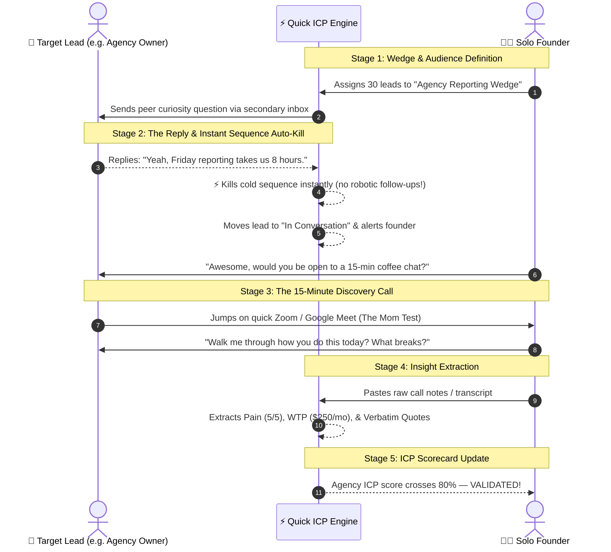

# Quick ICP ⚡

### *The Hypothesis-to-Conversation Engine for Early Founders*

[](file:///Users/shinojcm/Documents/quick-icp/LICENSE)
[](https://nodejs.org/)
[](file:///Users/shinojcm/Documents/quick-icp/CONTRIBUTING.md)
[](https://github.com/fridayowl/quick-icp)

> **De-engineer over-engineered products, discover your true ICP, and turn cold outreach into validated customer discovery conversations.**

---

## 🎯 The Vision: Why Quick ICP Exists

Solo technical founders and indie developers suffer from an epidemic: **we build too much before talking to customers.**

```
Traditional Failure Loop:
  [Build 15 Features for 4 Months] ➔ [Launch into Void] ➔ [Nobody Buys] ➔ [Assume Missing Features] ➔ [Repeat]

The Quick ICP Loop:
  [Define 3-5 ICPs] ➔ [Isolate 1-Feature Wedge] ➔ [Curiosity Outreach] ➔ [Instant Auto-Kill on Reply] ➔ [15-Min Call] ➔ [Extract Pain & WTP] ➔ [Validate Winner]
```

Traditional sales tools do not solve this:
* **Bulk email engines (UZonMail, Instantly alone)** blast 10,000 generic emails, ruining domain reputation without learning *why* prospects ignore the message.
* **Traditional CRMs (Twenty CRM, HubSpot alone)** are passive databases waiting for sales pipelines and deal values, not rapid hypothesis invalidation.

**Quick ICP merges the best of both worlds**:
1. **UZonMail-style multi-domain rotation and rate throttling** to protect your brand while sending targeted curiosity inquiries.
2. **Instant sequence auto-termination & live handoff** the moment a prospect replies.
3. **Twenty CRM-style lightweight discovery Kanban** tracking *Pain Severity (1–5)*, *Willingness to Pay*, and *Verbatim Quotes*.
4. **The "1-Feature Wedge" Studio**: Forces you to strip away 90% of your complex product and test one razor-sharp wedge per customer cohort.

---

## 🌊 The 5-Stage Customer Discovery Journey



---

## 🚀 Key Modules & Capabilities

| Module | What It Does | Why It Matters |
|---|---|---|
| **📦 Product & Feature Catalog (Twenty CRM Style)** | Document your company's product identity, list all 10–15 features in a monolith inventory, and calculate your De-Engineering Ratio. | Crucial for a company to know its full feature catalog before unbundling it into wedges. |
| **🧪 Multi-ICP Comparison Lab** | Compare 3–5 candidate audiences side-by-side with live validation scores (0–100%). | Prevents betting your startup on a single unvalidated audience hypothesis. |
| **🔪 The 1-Feature Wedge Studio** | Select a single 10% slice from your product catalog, with automatic calculation of **Discarded Features**. | Stops founders from overwhelming prospects with 12 features on call #1. |
| **📋 Discovery CRM Pipeline** | Twenty CRM-inspired Kanban board (`Outreach Active` ➔ `In Conversation` ➔ `Call Scheduled` ➔ `Call Logged` ➔ `Target Validated`). | Built specifically for *learning loops* rather than quota management. |
| **📬 Unified Discovery Inbox** | Multi-domain split view with automatic sequence kill and 1-click **"Propose 15-Min Coffee Chat"** templates. | Eliminates embarrassing robotic follow-ups after a prospect has already replied. |
| **🧠 AI Call & Transcript Analyzer** | Heuristic natural language parser converting messy Zoom notes into Pain Score (1–5) and Willingness to Pay ($/mo). | Replaces founder gut-feeling with objective, quantifiable validation metrics. |
| **🛡️ Safe Dispatcher & Warmup Pool** | Strict daily sending throttles (25–35 emails/domain) across rotated secondary domains with deliverability meters. | Protects your primary domain from spam filters and blacklists. |

---

## ⚡ Quick Start

### Prerequisites
- [Node.js](https://nodejs.org/) v18.0.0 or higher
- npm (installed with Node)

### 1. Clone & Install

```bash
# Clone the repository
git clone https://github.com/fridayowl/quick-icp.git
cd quick-icp

# Install dependencies (only Express and CORS!)
npm install
```

### 2. Start the Development Server

```bash
npm run dev
```

### 3. Open in Browser

Open [http://localhost:3030](http://localhost:3030) in your web browser.

The engine ships with pre-populated, interactive sample cohorts (Agencies, SaaS CTOs, E-Commerce Ops) so you can immediately test:
* Simulating inbound replies & seeing the instant sequence auto-kill.
* Dragging leads through the discovery pipeline.
* Analyzing messy call notes and extracting pain scores.
* Watching the dynamic ICP validation score update in real time.

---

## 📊 The Dynamic Validation Scoring Formula

Every ICP receives an objective Validation Score (0–100%) calculated dynamically:

$$\text{Score} = \min\left(100, \, F_{\text{reply}} + F_{\text{call}} + F_{\text{pain}} + B_{\text{validation}}\right)$$

* **Reply Engagement ($F_{\text{reply}}$)**: Up to 30 pts (normalized to a 25% reply rate benchmark).
* **Call Conversion ($F_{\text{call}}$)**: Up to 30 pts (normalized to 4 scheduled discovery calls).
* **Pain Severity ($F_{\text{pain}}$)**: Up to 25 pts (evaluated on a 1.0–5.0 scale).
* **Alpha Design Partner Bonus ($B_{\text{validation}}$)**: Up to 15 bonus pts for officially validated design partners.

When an ICP crosses **80%**, the engine marks it as **⭐ Validated Target**, signaling you have enough customer pull to build out the full wedge.

---

## 🛠️ Tech Stack & Philosophy

* **Backend**: Node.js v18+ + Express + Atomic Async JSON Store (`data/store.json`).
* **Frontend**: Vanilla ES Modules (`public/js/`), Native CSS Variables & HSL Palettes (`public/css/`), HTML5 `<dialog>`.
* **Zero Bloat**: No 500MB React/Next.js/Tailwind node_modules dependencies. Fast, inspectable, and instantly hackable.
* **Local-First**: Complete privacy. Your leads, call notes, and customer transcripts remain safely on your machine.

---

## 🗺️ Vision & Roadmap

- [x] Multi-ICP Hypothesis Comparison Matrix
- [x] 1-Feature Wedge & Discarded Features Definition
- [x] Twenty CRM-style Discovery Kanban Board
- [x] UZonMail-style Multi-Domain Unified Inbox & Auto-Kill
- [x] Rule-based Natural Language Pain & WTP Analyzer
- [ ] **v1.1**: Native Local LLM integration (Ollama / DeepSeek / Gemini) for deep transcript summarization.
- [ ] **v1.2**: Live IMAP/SMTP connectors for automated mailbox syncing.
- [ ] **v1.3**: Two-way sync export with [Twenty CRM](https://twenty.com) and HubSpot.
- [ ] **v1.4**: One-click PDF / Markdown Executive ICP Scorecard export for angel investors and co-founders.

---

## 📖 Deep-Dive Documentation

* [Founder Playbook: Zero to ICP](file:///Users/shinojcm/Documents/quick-icp/docs/FOUNDER_ZERO_TO_ICP_PLAYBOOK.md) — Step-by-step manual for founders who don't know where to start or who to sell to.
* [Architectural Specifications](file:///Users/shinojcm/Documents/quick-icp/docs/ARCHITECTURE.md)
* [The Quick ICP Vision & Manifesto](file:///Users/shinojcm/Documents/quick-icp/docs/VISION_AND_MANIFESTO.md)
* [Full System Reference](file:///Users/shinojcm/Documents/quick-icp/docs/quick_icp_documentation.md)
* [REST API Reference](file:///Users/shinojcm/Documents/quick-icp/docs/API.md)

---

## 🤝 Contributing

We welcome contributions from fellow founders, engineers, and product builders!
Please see [CONTRIBUTING.md](file:///Users/shinojcm/Documents/quick-icp/CONTRIBUTING.md) for guidelines on code style, roadmap discussions, and submitting pull requests.

Please review our [Code of Conduct](file:///Users/shinojcm/Documents/quick-icp/CODE_OF_CONDUCT.md) before participating.

---

## 📄 License

Quick ICP is open-source software licensed under the [MIT License](file:///Users/shinojcm/Documents/quick-icp/LICENSE).
