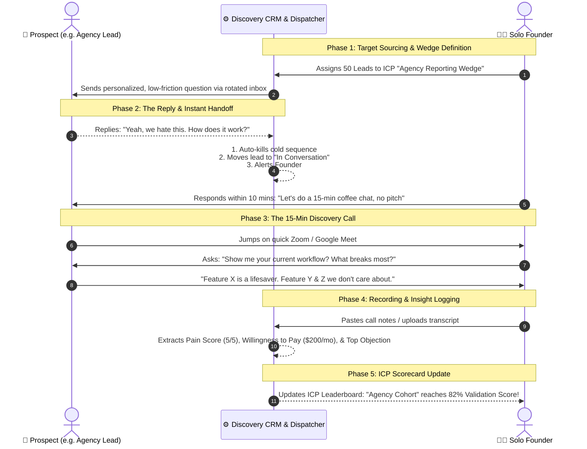

# Quick ICP — The Hypothesis-to-Conversation Discovery Engine
*A purpose-built system for solo founders & early-stage teams to de-engineer over-engineered products, discover their true ICP, and turn cold outreach into high-signal customer discovery conversations.*

---

## 1. Executive Summary & The Core Problem

When an engineer or solo founder builds a product, it often has 10–15 features, complex integrations, and immense technical flexibility—**but zero clarity on who is desperate enough to pay for it today**.

Traditional tools fail this stage:
* **Bulk email engines (UZonMail alone)** blast 10,000 generic emails, ruining domain reputation without validating customer problems.
* **Traditional CRMs (Twenty / HubSpot alone)** are passive databases that sit waiting for closed deals rather than accelerating learning loops.

**Quick ICP** blends the strengths of both:
* **Multi-inbox round-robin rotation & warmup throttles** (UZonMail heritage) to safely send low-pressure, curiosity-driven peer questions.
* **Instant sequence auto-termination & live conversational handoff** the second a prospect replies.
* **A lightweight Customer Discovery Pipeline** (Twenty CRM heritage) tracking *Problem Severity (1–5)*, *Willingness to Pay*, *Discarded Features*, and *Verbatim Customer Quotes*.
* **The "De-Engineering" Wedge Studio**: Forces founders to isolate a single 1-feature wedge per ICP until one emerges with an 80%+ validation score.

---

## 2. System Architecture & The 5-Stage Customer Journey



---

## 3. Core Modules & Feature Breakdown

### Module 1: The Multi-ICP Lab & Matrix
* **Parallel Hypothesis Testing**: Test 3–5 candidate customer profiles side-by-side (e.g., *Boutique Agencies* vs. *SaaS CTOs* vs. *E-commerce Ops*).
* **The 1-Feature Wedge**: Forces you to specify the single 10% slice of your product you are testing (e.g., *1-Click Automated White-label Report Generator*).
* **Discarded Features (Monster De-Engineering)**: Explicitly tracks what features *not* to pitch to this audience (e.g., *No webhooks, no database sync, no custom JS nodes*).
* **Validation Score Gauge (0–100%)**: Dynamically calculated formula:
  $$\text{Score} = \text{Reply Factor (30\%)} + \text{Call Factor (30\%)} + \text{Pain Severity \& WTP (25\%)} + \text{Alpha Validation Bonus (15\%)}$$

### Module 2: Discovery CRM Pipeline (Twenty CRM Heritage)
* Drag-and-drop Kanban board across stages:
  1. `Outreach Active`: Sequence active across secondary inboxes.
  2. `In Conversation`: Sequence auto-killed; founder in direct contact.
  3. `Discovery Call Booked`: 15-minute feedback chat scheduled.
  4. `Call Logged / Evaluated`: Structured notes and pain scores recorded.
  5. `⭐ ICP Validated`: Design partner alpha qualified with confirmed pain and willingness to pay.
  6. `Wrong ICP / Disqualify`: Low pain or high friction; pivot signal logged.

### Module 3: Unified Discovery Inbox (UZonMail Heritage)
* Single unified split-screen view across all secondary sender domains.
* Automatically marks threads with **"⚡ Cold Sequence Auto-Terminated"** when a prospect replies.
* One-click **"Insert 15-Min Discovery Ask"** template to propose a casual coffee chat.
* Includes a **"Simulate Inbound Prospect Reply"** button for testing the immediate auto-kill and handoff flow.

### Module 4: Discovery Call & Transcript Insight Extractor
* Paste raw, messy notes from Zoom/Meet or audio transcripts.
* Instant heuristic extraction:
  * **Pain Severity (1 to 5 flame rating)**: Nuisance vs. bleeding-neck problem.
  * **Wedge Resonance**: Which exact feature made their eyes light up?
  * **Discarded Features**: What parts of the product did they say they don't care about?
  * **Willingness to Pay (WTP)**: e.g., "$150 - $250 / month".
  * **Verbatim Customer Quotes**: Captured word-for-word for future marketing copy.

### Module 5: Multi-Inbox Safe Dispatcher & Warmup Pool
* Enforces safe daily throttles (25–35 emails/day/inbox) across secondary domains to protect your primary domain reputation.
* Live deliverability health meters (98%, 95%).
* Pre-loaded with low-friction, peer-question sequence templates.

---

## 4. Local Project Installation & Setup

### How to Run:
```bash
# 1. Clone repository
git clone https://github.com/fridayowl/quick-icp.git
cd quick-icp

# 2. Install dependencies
npm install

# 3. Start development server (with live reload)
npm run dev

# 4. Open in browser:
# http://localhost:3030
```

---

## 5. Technology Stack

* **Backend**: Node.js v25 + Express + Persistent JSON Store (`data/store.json`).
* **Frontend**: Modern Vanilla HTML5 & Vanilla CSS with CSS custom properties, HSL color system, and native `<dialog>` modals with `::backdrop` blur.
* **Typography**: Outfit, Inter, and JetBrains Mono (via Google Fonts).
* **Dependencies**: Zero external frontend framework bloat; fast, lightweight, and responsive.
